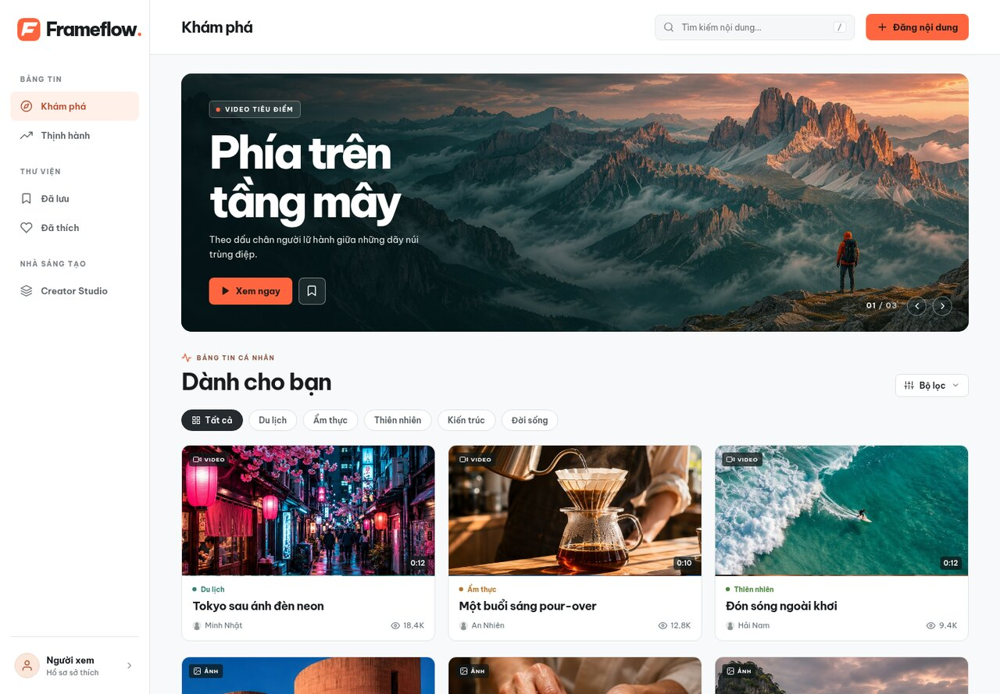

# Frameflow

Demo tiếng Việt cho môn Dữ liệu lớn (CO3137). Người đăng đưa ảnh hoặc video vào thư viện. Người xem khám phá nội dung và cá nhân hóa bảng tin bằng lượt xem, lượt thích, lượt lưu và phản hồi giảm đề xuất.



## Chạy trên máy

Cần Node.js 22, npm và FFmpeg (gồm hai lệnh `ffmpeg` và `ffprobe` trong PATH để xử lý tệp đăng lên máy chủ). Tại thư mục gốc của repo, chạy:

```sh
npm ci
npm start
```

Mở trình duyệt tại `http://localhost:3000`. Máy chủ phát triển chạy cả React và API. Để dùng bản production, chạy `npm run build` rồi `npm run serve`. Thư mục `.frameflow/` lưu nội dung đăng và lượt xem trên máy chủ. Có thể cấu hình đường dẫn lưu trữ bằng biến `FRAMEFLOW_DATA`.

## Trình diễn trong ba phút

1. Mở **Một buổi sáng pour-over**, nhấn **Thích** và **Lưu**, sau đó đóng trình phát. Trên hồ sơ mới, **Nghệ thuật trong từng miếng sushi** sẽ lên đầu bảng tin. Mở mục đó để xem lý do đề xuất và metadata.
2. Nhấn **Đăng nội dung**, chọn một ảnh hoặc video. Quan sát độ phân giải, dung lượng và thời lượng được trích xuất, sau đó nhập tiêu đề, chủ đề, tác giả và thẻ. Khi đăng thành công, mục mới xuất hiện trong **Creator Studio**.
3. Với bản có máy chủ, mở cùng địa chỉ trong cửa sổ ẩn danh. Tìm tiêu đề vừa đăng để xem nội dung dưới vai trò một người xem mới. Sở thích của hai trình duyệt độc lập. Chọn **Người xem → Đặt lại sở thích** để bắt đầu lại phần cá nhân hóa.

## Dữ liệu đi qua hệ thống như thế nào?

- **Tiếp nhận** — Nhận JPEG, PNG, WebP, MP4 hoặc WebM tối đa 32 MB. Trình duyệt đọc metadata để xem trước. Máy chủ kiểm tra tệp bằng ffprobe, tạo ảnh bìa bằng FFmpeg rồi ghi bản ghi vào thư viện.
- **Metadata** — Loại tệp, dung lượng, chiều rộng, chiều cao và thời lượng đến từ media. Tác giả nhập tiêu đề, chủ đề và thẻ ngữ nghĩa.
- **Xếp hạng** — Khi chưa có lịch sử, bảng tin dùng độ phổ biến và ưu tiên nội dung mới đăng. Hồ sơ sở thích tích lũy điểm cho chủ đề và thẻ qua thao tác mở (+1), xem ít nhất 75% video (+2), thích (+3), lưu (+4) và giảm đề xuất (−7). Mỗi tín hiệu được tính một lần trên mỗi mục. So khớp chủ đề có trọng số gấp đôi so với thẻ. Nội dung đã mở bị giảm điểm. Mục đã ẩn được loại khỏi bảng tin.
- **Hai vai trò** — API chia sẻ thư viện giữa các trình duyệt. Cookie ẩn danh nhận diện nhà sáng tạo và giúp đếm mỗi trình duyệt một lượt xem cho mỗi mục. Sở thích người xem lưu trong localStorage.
- **Bộ mẫu** — Bảy mục với hình minh họa được tạo cho demo. Bốn video MP4 là các đoạn chuyển động từ ảnh. Lượt xem ban đầu và tên tác giả là dữ liệu minh họa. Bản có máy chủ cộng thêm lượt xem thực tế.

## Bản trình chiếu một tệp

Chạy `npm run demo:html`, sau đó mở `build/Frameflow.html` bằng Chrome. Tệp đóng gói sẵn cả ứng dụng, ảnh, video và phông chữ để trình diễn ngoại tuyến. Ở chế độ một tệp và khi chỉ triển khai thư mục build lên hosting tĩnh, bài đăng lưu bằng IndexedDB trong trình duyệt. Để chia sẻ bài đăng giữa nhiều máy, dùng bản Node có API.

## Kiểm tra

```sh
CI=true npm test -- --watch=false --runInBand
npm run build
```

Các bài kiểm thử kiểm tra thứ tự khuyến nghị sau tín hiệu tích cực và tiêu cực. Đây là demo hệ thống khuyến nghị dựa trên nội dung, xử lý thư viện quy mô lớp học trên một máy chủ.
