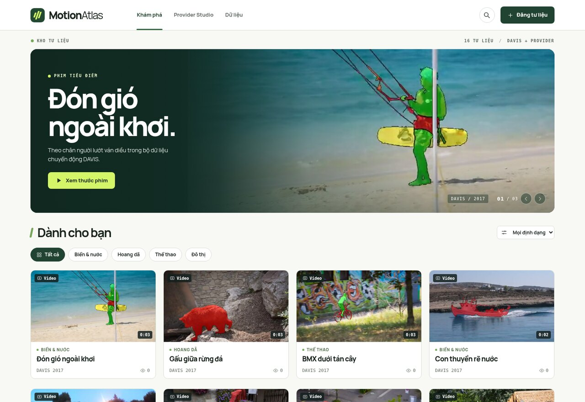

# Motion Atlas

Web demo cho môn Big Data (CO3137). Provider đăng ảnh/video, pipeline trích metadata, Customer khám phá nội dung và tạo tín hiệu cho hệ thống khuyến nghị. Kho mẫu sử dụng video nghiên cứu **DAVIS 2017** với lớp chú thích đối tượng có sẵn trên hình.



[**Xem sơ đồ kiến trúc và cách tính điểm**](docs/ARCHITECTURE.md) · [Nguồn, giấy phép và từ điển dữ liệu](data/SOURCES.md)

## Mở trên Windows

1. Tải ZIP của nhánh `main` trên GitHub rồi **giải nén**.
2. Với **Python 3.10 trở lên**, nhấp đúp **start-windows.cmd**. Trình duyệt sẽ mở Motion Atlas. Giữ cửa sổ dòng lệnh mở trong lúc dùng.
3. Để đăng và phân tích tệp mới, cài FFmpeg có cả `ffmpeg` và `ffprobe` trong PATH rồi mở lại máy chủ. Với Windows có winget, dùng `winget install --id Gyan.FFmpeg -e`. Kho mẫu, bảng tin, tương tác và trang Dữ liệu chạy ngay bằng Python.

Từ PowerShell trong thư mục đã giải nén, cũng có thể chạy `python server.py --open`. Trên macOS/Linux chạy `python3 server.py`, rồi mở `http://localhost:3000`. Nếu đã quen npm, `npm start` gọi cùng máy chủ Python. Dự án dùng thư viện chuẩn Python và JavaScript trình duyệt.

## Thử trong ba phút

1. Vào **Dữ liệu**, kéo thanh thời gian để xem một khung hình của video gốc. Biểu đồ được tính từ toàn bộ **3.269 frame**. Bảng tin lấy **16** tư liệu ngắn có mốc nguồn xác định.
2. Với hồ sơ mới, mở **Đón gió ngoài khơi**, xem hết và bấm **Thích**. Quay về feed, mở **Lướt trên đầu sóng** và xem lý do đề xuất. Tab Dữ liệu cập nhật các sự kiện thật vừa phát sinh.
3. Vào **Provider Studio** để đăng tệp. Trong cửa sổ ẩn danh, mở lại cùng địa chỉ và tìm tiêu đề đó. Người xem mới thấy bài đăng và có lịch sử sở thích riêng.

SQLite và bài đăng nằm ở `.runtime/`. Đặt biến `MOTION_DATA` để chọn nơi lưu khác. Máy chủ mặc định chỉ nghe trên máy đang chạy. Để trình diễn giữa các máy trên cùng mạng, chạy `python server.py --host 0.0.0.0 --port 3000` và dùng địa chỉ LAN của máy chủ. Bản này dùng hồ sơ bằng cookie cho phạm vi lớp học.

## Tái tạo pipeline và chạy kiểm tra

Các lệnh sau chạy ở gốc repo. Bản đã tải có sẵn media và các kết quả tính toán.

```sh
python pipeline/build.py
python -m pipeline.evaluate
python -m unittest discover -s tests -v
```

Lệnh đầu tải video nguồn cố định, xác minh SHA-256 rồi tái tạo media, metadata và thống kê từ FFmpeg. Cũng có thể dùng tệp có sẵn với `python pipeline/build.py --source web/media/davis-trainval.mp4`. Bài đánh giá truy hồi dùng nhãn chủ đề ẩn ở thời điểm chấm và ghi kết quả theo từng truy vấn vào `web/evaluation.json`.
