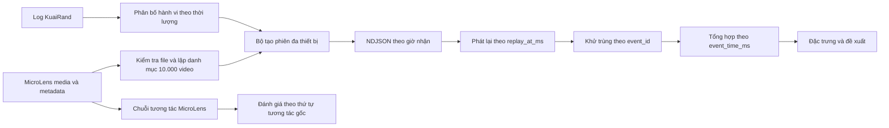

# Kiến trúc dữ liệu Motion Atlas

Tại thời điểm tiếp nhận, kiểm tra liên kết ID và lưu dấu vết bản phát hành. Với mỗi video nhập thành công, tải metadata kỹ thuật và tính đặc trưng từ chính tệp media. Khi tạo stream, lấy mẫu hành vi KuaiRand theo nhóm thời lượng, gán phiên và thiết bị, rồi tạo độ trễ gửi. Giữ thứ tự thời gian hành động khác với thứ tự nhận để đo cách xử lý dữ liệu đến muộn.

Đánh giá khả năng xử lý streaming trên luồng mô phỏng. Đánh giá khả năng đề xuất video tiếp theo trên các chuỗi MicroLens thật đã giữ riêng, chia theo thứ tự tương tác. Bảng tin web hiện nhận tệp người dùng tải lên và ghi tương tác trực tiếp vào SQLite. Luồng nghiên cứu và định dạng NDJSON được mô tả ở [thiết kế dữ liệu](../data/SOURCES.md).
