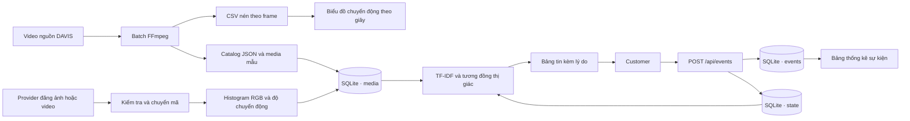

# Kiến trúc Motion Atlas

Hai câu hỏi dẫn dắt thiết kế: một tư liệu mới chưa có lượt xem sẽ xuất hiện ở đâu, và bảng tin thay đổi thế nào khi người xem bộc lộ sở thích? Motion Atlas dùng nội dung để khởi tạo đề xuất, sau đó cập nhật thứ tự ngay khi có phản hồi.

## Dữ liệu đi vào

| Nhánh | Đầu vào thực tế | Đầu ra |
| --- | --- | --- |
| Xử lý theo lô | Video giới thiệu TrainVal từ kho chính thức DAVIS, xác minh SHA-256 | 3.269 dòng theo khung hình, timeline 164 khoảng một giây, 16 mục trong catalog |
| Người cung cấp | JPEG, PNG, WebP, MP4 hoặc WebM. Tối đa 32 MB, video tối đa 90 giây | Tệp đã chuẩn hóa, ảnh bìa, metadata kỹ thuật của tệp gốc và bản phát, đặc trưng thị giác |
| Người xem | Mở, xem ít nhất 75% thời lượng, thích, bỏ thích hoặc bỏ qua | Nhật ký sự kiện có thời gian UTC và trạng thái theo cặp người xem–tư liệu |

**Metadata tự động** gồm codec, độ phân giải, dung lượng, thời lượng, số frame giải mã được, histogram và độ chuyển động. **Metadata biên tập** gồm tiêu đề, chủ đề và thẻ. Mỗi mục DAVIS giữ mốc bắt đầu/kết thúc trong nguồn. Màu phủ trên đối tượng đã có trong video nghiên cứu của DAVIS và ảnh hưởng tới đặc trưng màu.

## Từ khung hình đến vector

FFmpeg giải mã tuần tự và thu nhỏ mỗi khung hình về 32 × 18 pixel RGB. Pipeline chia mỗi kênh màu thành bốn khoảng cường độ, chuẩn hóa tần suất rồi lấy trung bình theo thời gian. Một tư liệu được biểu diễn bằng 12 giá trị màu. Giá trị thứ 13 là mức thay đổi tuyệt đối trung bình giữa hai khung hình liên tiếp, chuẩn hóa về 0–1. Ảnh tĩnh có giá trị chuyển động bằng 0.

Bước trích xuất giữ khung hiện tại và khung trước trong bộ nhớ. File CSV nén lưu các phép đo theo frame của video nguồn để có thể phân tích lại. Web đọc bản tổng hợp theo giây khi mở trang **Dữ liệu**.

## Xếp hạng khi có sự kiện

1. Khi chưa có sở thích, dùng số người xem riêng biệt rồi thứ tự biên tập để phá hòa. Tư liệu mới đăng được ưu tiên khi bằng điểm.
2. Mức giống giữa hai tư liệu là **65% cosine TF-IDF** trên chủ đề/thẻ, **25% giao nhau của histogram màu** và **10% độ gần về chuyển động**.
3. Mỗi mục từng tương tác đóng góp trọng số riêng: mở +1, xem ít nhất 75% +2, thích +4. Bỏ qua chuyển trọng số của mục đó thành −4 và ẩn mục đó khỏi feed. Điểm sở thích là tổng độ giống nhân trọng số chia cho tổng trị tuyệt đối của các trọng số. Hệ thống loại chính mục đang chấm ra khỏi lịch sử so sánh.
4. Cộng một phần độ phổ biến thực tế, trừ điểm nếu người xem đã mở mục đó. Trả về thứ tự và một lý do có thể đối chiếu với tư liệu mà họ đã xem.

Mỗi sự kiện có UUID. Ghi nhật ký và cập nhật trạng thái nằm trong một giao dịch SQLite. Gửi lại cùng UUID chỉ được tính một lần. Bấm xem nhiều lần vẫn có thể tạo nhiều sự kiện mở, còn lượt xem trên thẻ nội dung đếm theo người xem riêng biệt. Cookie ẩn danh nhận diện trình duyệt. Provider Studio liệt kê các bài đã đăng bằng trình duyệt đó.

## Đo chất lượng và giới hạn

Bài đánh giá ngoại tuyến lần lượt lấy từng mục mẫu làm truy vấn, loại chính nó khỏi ứng viên, ẩn chủ đề và loại thẻ trùng nguyên văn với các nhãn chủ đề. Sau đó so ba kết quả đầu với nhãn biên tập. Precision@3 đạt **50,0%**, tương đương **24/48** vị trí cùng chủ đề. Kỳ vọng khi chọn ngẫu nhiên là **20,8%** theo phân bố chủ đề trong tập này. Dữ liệu nhỏ và thẻ mô tả do biên tập viên gắn khiến kết quả chỉ có ý nghĩa như kiểm tra truy hồi nội dung. Để đo mức hài lòng cần phản hồi độc lập của người xem.

Bản chạy lớp học dùng một tiến trình phục vụ HTTP đa luồng, SQLite WAL và tệp media trên đĩa. Upload xử lý đồng bộ, với thời gian chờ phụ thuộc độ dài video. Xếp hạng quét thư viện và so với lịch sử của từng người xem. Khi lưu lượng tăng, các điểm cần tách trước là worker trích xuất sau hàng đợi, object storage cho video, xử lý sự kiện theo phân vùng và chỉ mục tìm ứng viên. Đây là các hướng mở rộng của kiến trúc.

## Điểm vào trong repo

| Thành phần | Tệp |
| --- | --- |
| Danh sách trích đoạn có mốc thời gian | [selections.csv](../data/selections.csv) |
| Tải nguồn, kiểm tra hash và tạo dữ liệu mẫu | [pipeline/build.py](../pipeline/build.py) |
| Giải mã và lấy đặc trưng | [pipeline/features.py](../pipeline/features.py) |
| API, lưu trữ và luồng upload | [server.py](../server.py) |
| Tính điểm và giải thích | [recommender.py](../recommender.py) |
| Đánh giá ngoại tuyến | [pipeline/evaluate.py](../pipeline/evaluate.py) |
